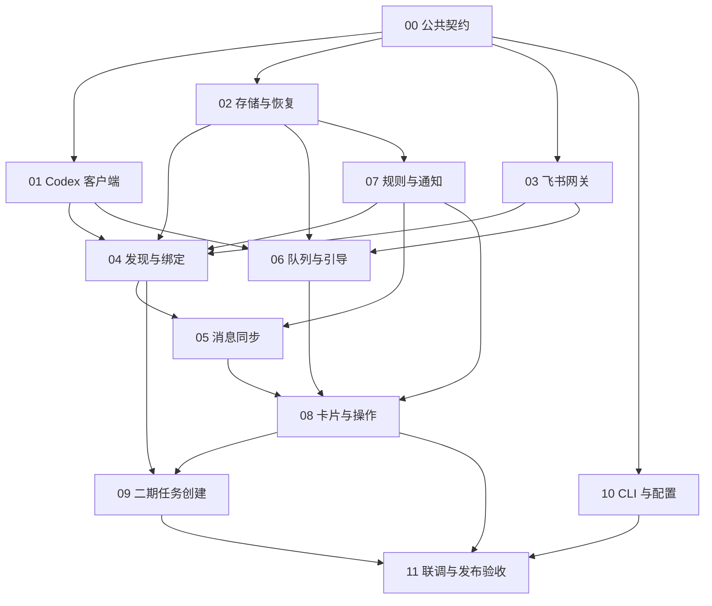

# Codex × 飞书开发手册

更新：2026-10-12。实施方案已确认；本文是开发规格，M0 真实可行性联调已通过，正在整合 M1–M3 正式服务，尚非一期发布。

第一期交付你的常用流程：在 Codex App 的远程机器上发起任务，自动建飞书群，两端持续对话。执行中补充消息默认进入 Codex 原生队列；点击卡片“追加引导”才进入当前轮。第二期交付飞书内新建任务、目录选择、专属群或话题跟进。CLI 界面的外部输入回显不在两期范围内。2026-10-12 用户调整：fork 跟进暂缓，代码留 TODO；普通 App 和注册工作树仍继续实现。

## 从哪里开始

| 用途 | 文档 |
| --- | --- |
| 开发入口、接口和目录约定 | [00 公共契约](00-contracts-and-layout.md) |
| 接入共享 Codex 服务 | [01 Codex 客户端](01-codex-client.md) |
| 持久化、幂等、断线恢复 | [02 存储与恢复](02-store-and-recovery.md) |
| 飞书事件、API、权限、群和话题 | [03 飞书网关](03-feishu-gateway.md) |
| App 会话发现、自动建群和绑定 | [04 发现与绑定](04-discovery-and-bindings.md) |
| 人类/AI 双向同步 | [05 消息同步](05-message-sync.md) |
| 默认排队、追加引导、停止与恢复 | [06 输入队列与引导](06-queue-and-steering.md) |
| 目录 mute、@ 与免打扰 | [07 规则与通知](07-rules-and-notifications.md) |
| 原生卡片和操作回调 | [08 卡片与操作](08-cards-and-actions.md) |
| 第二期飞书新建任务 | [09 任务创建](09-feishu-task-creation.md) |
| CLI、安装、配置与诊断 | [10 CLI 与配置](10-cli-and-setup.md) |
| 实施顺序、联调和发布门槛 | [11 集成与验收](11-integration-and-acceptance.md) |
| 交给 Agent 自动配置 | [Agent 一键配置指南](AGENT-SETUP.md) |

开发文档中的包、接口、命令和表结构是待实现的契约。真实可用的软件必须先完成相应模块和验收，不能因为文档中出现了命令就声称安装成功。配置指南为自包含执行说明；给配置 Agent 单独提供它即可，开发 Agent 则从本手册开始。

## 已固定的产品行为

| 能力 | 行为 | 阶段 / 模块 |
| --- | --- | --- |
| 自动建群 | 第一条实际输入后，一条主会话对应一个专属群；首次安装不扫历史批量建群 | 一期 / 04 |
| 双向上下文 | Codex 端人类输入、AI 公开回复镜像到飞书；飞书输入进入同一会话 | 一期 / 05、06 |
| 执行中补充 | 普通输入统一调用原生 queue/add；引导必须点击按钮 | 一期 / 06、08 |
| 过程与结果 | 每轮一张过程卡持续更新，完成后单独发最终回复；飞书输入不重复镜像 | 一期 / 05、08 |
| 原消息反馈 | 飞书原消息 reaction 跟随接收 / 排队 / 执行 / 完成状态 | 一期 / 03、05 |
| 操作反馈 | 未确认的请求显示“正在核验”，不先显示“成功” | 一期 / 02、06、08 |
| 目录 mute | 精确目录或递归子孙；仅影响未来自动建群；已绑定任务继续同步 | 一期 / 04、07 |
| @ 提醒 | 最终结果、失败、待用户处理时提醒配置用户；休息时继续同步正文 | 一期 / 07 |
| 飞书创建 | /new、机器人单聊普通消息、入口群 @ 消息均可发起 | 二期 / 09 |
| 跟进位置 | 默认专属群；可选择工作群中的话题；话题内容严格留在话题 | 二期 / 03、09 |
| 权限与审批 | 沿用原 App 会话策略；本期审批与原生问答提示回 App 处理 | 一期 / 01、05、08 |

单机、单远程系统用户部署。开发为独立 Go CLI 项目，不把工具接进当前邮件网关，也不沿用该仓库的旧版飞书 SDK。参考 code-anywhere 的建群、mute、关闭 @ 语义；卡片和后端结构按本手册重新实现。

## 依赖关系



依赖图表达用例联调时的数据与能力依赖，不等同于 Go 包的 import 图。共享 DTO 放 domain，cards 不导入 sync/submissions，也不发 RPC。先交付最小真实链路，再按里程碑补齐恢复与边界；具体顺序见 11。

## 证据与未完成项

已在本机 Codex CLI / 共享 App Server **0.162.0** 验证共享线程、事件、原生队列、引导、断线及空闲入口，共 27 项断言通过。测试使用本地模拟模型；这是协议证据，尚未证明真实 App 页面和飞书客户端的完整体验。

M0 已在真实 App 看到飞书输入、AI 回复与原生排队；真实飞书私聊、群 @、建群、回调已通过。用户已确认每轮过程卡更新、单独最终回复、原消息 reaction 的新版交互。追加引导 UI 也已由用户确认，引用回复 parent_id 已实际读回验证；群成员权限、真实 @、手机长代码 fixture 与 UUID 即时重复已通过；真实 App fork/worktree/子代理分类已于 2026-10-12 补验通过；自动发现、故障恢复与一期发布矩阵仍需完成。详见[M0 进展](../research/m0-live-integration-2026-10-10.md)。原生实验接口按验收过的版本发布兼容清单，升级后不能跳过这些门槛。

- [已确认实施方案](../research/codex-feishu-implementation-proposal-2026-10-10.md)
- [开源调研](../research/codex-feishu-bridge-2026-10-10.md)
- [飞书权限研究](../research/feishu-m0-permissions-2026-10-10.md)
- [准确版本线程分类](../research/thread-classification-0.162.0.md)
- [首装基线与草稿发现研究](../research/discovery-baseline-0.162.0.md)、[M1 基础实现进展](../research/m1-discovery-foundation-2026-10-12.md)
- [运行时、持久输入与目录规则](../research/m1-runtime-and-m2-inputs-2026-10-12.md)
- [正式服务、命令与任务控制整合进展](../research/m2-service-and-task-controls-2026-10-12.md)
- [配置向导、用户服务与待处理提醒进展](../research/m3-setup-and-request-reminders-2026-10-12.md)
- [受控忙时测试的本轮释放](../research/m3-managed-turn-release-2026-10-12.md)
- [管理通道、状态核验与离线取消进展](../research/m3-control-and-offline-cancel-2026-10-12.md)
- [只读诊断与内嵌权限清单](../research/m3-doctor-and-permissions-2026-10-12.md)
- [私聊配对与 Agent 配置指引进展](../research/m3-pairing-2026-10-12.md)
- [通知配置事务与恢复](../research/m3-policy-apply-2026-10-12.md)
- [正式消息限流恢复](../research/m3-rate-limit-delivery-2026-10-12.md)
- [飞书 unknown 的读回证据与隐藏标记](../research/feishu-unknown-readback-2026-10-12.md)
- [旧 M0 原群与历史卡片接管](../research/m3-legacy-adoption-2026-10-12.md)
- [验证命令与数据库保护](../research/m3-verify-safety-2026-10-12.md)
- [准确版本审批与问答路由](../research/approval-routing-0.162.0.md)
- [卡片组件研究](../research/codex-feishu-card-ux-2026-10-10.md)
- [主链路验证](../research/codex-feishu-probes-2026-10-10/native-queue-probe-result.json)、[并发与边界](../research/codex-feishu-probes-2026-10-10/native-race-probe-result.json)、[空闲入口](../research/codex-feishu-probes-2026-10-10/native-idle-queue-probe-result.json)

## 给开发 Agent 的任务格式

```text
请先读本仓库适用的 AGENTS.md，并执行其 CodeGraph 就绪检查。
再读 docs/codex-feishu/README.md、00-contracts-and-layout.md 和指定模块文档。
任务：实现模块 <编号> 的 <具体交付切片>，不要跨到后续阶段。
代码仓库：<独立 codex-feishu 仓库绝对路径>。
文件所有权：<包 / 文件>；你与其他开发者共享代码，保留他人的修改。
依赖版本 / 已实现接口：<实际情况>。
验收：<模块中的场景编号及本切片所需集成场景>。
输出：变更、验证证据、未通过项；不得把未联调能力写成已完成。
```

一次任务应形成可评审的切片。涉及公共契约变更时先说明具体冲突，再同步更新相关模块；不要在一个模块里另造执行队列或绕过同会话约束。
