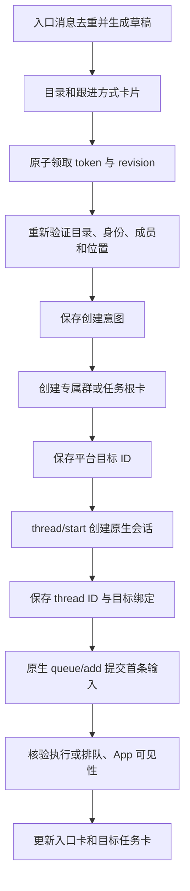

# 从飞书新建 Codex 会话：技术方案

整理日期：2026-10-15。来源：最初确认的双向同步方案中“第二期飞书创建”部分，以及模块 09 开发手册。本文将其整理为可独立交接的技术方案，并纳入后来确认的群名前缀、卡片、引用回复及原生审批/问答约定。

状态：第二期技术设计，已进入候选实现与联调，详见[实施与验收记录](../records/feishu-create-codex-session-implementation-2026-10-15.md)，完整真实客户端验收仍待完成。复用当前远程主机上的共享 Codex App Server 和既有桥接服务；`creation.enabled` 默认关闭，本机候选按用户授权开启联调。附件输入是另一项增量，见[附件方案](feishu-inbound-attachments-plan-2026-10-15.md)，不混淆两者的完成状态。

## 1. 交付目标

用户在飞书发起任务，在卡片中选择远程工作目录和跟进位置；机器人创建真正的 Codex 会话，用户可在飞书和 Codex App 中持续跟进同一个 thread ID。

已确认的产品约定：

1. `/new` 和普通消息都能触发创建，不要求所有任务先输入命令。
2. 创建前有卡片交互，选择一个最终目录；不能偷偷使用桥接服务进程的 cwd。
3. 跟进位置默认“新建专属群聊”，可改为“工作群话题”。
4. 在已绑定任务群中的普通 @ 消息继续当前会话；只有明确 `/new` 才新建。
5. 新专属群名带一个 `🤖 ` 前缀，后续跟随 App 的会话标题；工作目录写入群描述。
6. 普通补充输入默认进入原生队列；点击“追加引导”才进入当前轮；停止保留队列，显式继续。
7. 过程每轮一张卡持续更新，最终结果单独发送；使用真实消息引用和 reaction。
8. 沿用原生权限策略和现有审批/问答卡片能力；不为新任务自动提高执行权限。
9. CLI 的外部输入界面回显及 fork 跟进继续沿用既有范围约定，不是本功能验收项。

## 2. 入口路由

| 位置与输入 | 处理 |
| --- | --- |
| 机器人单聊：`/new`、`/new 任务描述` 或普通文字 | 创建草稿，预填任务正文 |
| 已配置、未绑定的入口群：@机器人 `/new` 或普通文字 | 创建草稿；当前群可以作为话题候选 |
| 已绑定专属任务群：普通 @ 文字 | 提交到原线程，不创建新草稿 |
| 已绑定专属任务群：@机器人 `/new` | 创建新草稿，默认新专属群 |
| 已绑定话题：普通 @ 文字 | 跟进该话题对应的原线程 |
| 有多个话题的工作群，用户在话题外 @ | 不猜最近会话；提示进入对应话题或明确新建 |
| 未授权发送者或未授权入口群 | 拒绝创建或提供简短使用说明 |

命令解析优先于普通任务路由。已有 `/notify`、`/mute-dir`、`/stop` 等命令继续由原模块处理，管理命令输错时提示纠正，不将其变成新任务正文。群内授权仍依据结构化 mentions，而不是正文里的机器人名字。

一期的绑定群路由和二期入口群路由须分别配置。不能因为机器人加入某个群，就允许群中所有人创建可执行会话。

## 3. 创建卡与目录选择

创建卡展示远程主机、任务正文、已选目录、可核验的项目归属、跟进方式和目标工作群，只有一个最终“创建任务”主按钮。未填写必需字段时保持草稿。

卡片复用当前正文优先样式：无彩色大标题，短状态、紧凑操作区、细节折叠；长目录保留完整值但不撑满首屏。目录浏览另开选择卡，选完返回原草稿，不能产生多个互相冲突的最终目录值。

目录来源：

- 共享 App Server 的 `project/list` 中可核验的项目目录。
- 配置允许范围内的常用目录和该操作者最近确认使用的目录。
- 用户通过“其他目录”浏览或输入的绝对路径。

只对需要展示的目录分页读取，不递归扫描整台主机。提交时在远程执行主机重新检查真实路径、存在性、可访问性、配置允许范围和项目匹配；符号链接和路径边界判断复用现有目录规则。默认最近目录也必须再次校验，不能继续使用已经删除或失去权限的目录。

只有目录与项目关系能够核验时，才传 `projectId`；否则以独立目录创建并明确展示。普通注册 worktree 使用其真实目录；fork/worktree 派生跟进不借此扩大范围。

`mute-dir` 控制未来 App 会话的自动建群，不阻止操作者主动在飞书创建任务。目录浏览允许范围和自动发现范围是不同职责，配置向导应分别说明。

## 4. 跟进位置

### 4.1 新建专属群聊：默认

创建配置 owner、创建者及必要成员与机器人所在的任务群。群名走现有标题生成和 `WithRobotPrefix` 逻辑，确保恰好一个 `🤖 `；初始可使用任务描述的短标题，之后跟随原生会话标题和 App 改名。群描述记录实际工作目录。

新群保存一张任务根卡，展示用户提交的任务内容、目录和真实来源。若创建入口在单聊或另一个群，原入口消息不在新群里，不能把它作为新群内 Reply API 的父消息；过程和结果应引用新群内的任务根卡。入口创建卡单独更新为已创建，提供经过核验的群入口。

原任务正文只在目标群建立一次可见上下文。首条原生输入与桥收据关联后，不能又被普通人类镜像流程重复发一份；后续在目标群发送的用户消息仍遵守现有不重复回显规则。

### 4.2 工作群话题：可选

从授权工作群入口发起时可选择当前群；从机器人单聊发起时需要选择一个已授权工作群。没有可靠默认群时必须选择，不能把单聊或任意历史群作为隐式目标。

在目标工作群发送任务根卡，保存根消息 ID，随后通过明确的话题回复参数跟进，并保存平台返回的 thread ID（如有）。话题支持、根卡与回复关系先做真实飞书验证，再开启该模式。

所有过程、最终结果、队列操作、审批/问答卡片和任务错误都沿用同一个话题目标。根消息失效或平台拒绝话题回复时停止该目标的投递并显示需要修复，不降级为工作群主消息。

话题内 `parent_id/root_id` 的含义必须按平台实际事件核验；不能把任意回复的 parent 当作被用户选中的具体子消息。路由依据至少包含 chat ID 和可核验的 root/thread 身份，不按名称或“最近任务”定位。

## 5. 共享 Codex 接入及 App 可见性

复用当前主机、当前系统用户的共享 App Server，动态发现端点并检查实际版本。创建任务不启动新的 daemon 或 app-server，也不运行另一套 CLI `exec/resume` 代替共享会话。

当前本机 0.162.1 导出 schema 的 `ThreadStartParams` 包含 `cwd`、`projectId`、`threadSource`、`ephemeral` 等字段，`ProjectListParams` 支持分页。字段存在不等于二期真实 App 可见性已通过，实施时仍要检查目标版本。

创建使用以下参数语义：

```text
thread/start
  cwd          = 用户最终确认的远程目录
  projectId    = 已核验的项目标识（可省略）
  threadSource = 当前版本支持的桥自建来源标记
  ephemeral    = false
  权限及模型   = 用户/项目的既有有效策略；不注入本开发会话的特殊配置
```

不将“当前 Agent 可以执行”当作新线程也应拥有的权限。核验创建响应中的 cwd、原生 thread ID 和实际生效策略，失败时不先显示创建成功。

拿到 thread ID 后，在创建它的原连接上提交首条原生输入，沿用 `thread/queue/add` 和同一个 input receipt。首条输入产生前 rollout 可能尚未存在，另一客户端暂时 read/resume 失败不表示线程不存在；不能因此重新 `thread/start`。

等待首条输入落盘和完整历史/事件确认，再验证 App 中出现该线程、目录和项目正确，且两端能继续相同 thread ID。若 App 只能执行但无法稳定展示或续接，该项保持未验收，不把协议创建成功当作产品交付。

## 6. 创建流程及持久状态



草稿至少保存：创建者、入口 message/chat ID、任务文本、host、最终目录、可选 project ID、跟进方式、目标工作群、revision、动作令牌和期限。修改草稿不创建任何远程对象，重复入口事件不新建第二份草稿。

创建意图拆成目标创建、原生线程创建、绑定保存和首条输入等独立步骤。每个远程步骤在发送前冻结其参数和操作身份，写入 `prepared/dispatching`，收到确定结果后保存 `confirmed/rejected`；超时、连接中断或确认落库失败为 `unknown`。远程调用不放进 SQLite 事务。

重复点击、旧卡点击、手机与桌面同时提交，只允许同一个草稿版本领取一次创建意图；重复动作显示原意图的当前进度，不重新从第一步执行。连接重启后先恢复未决操作，再开放对应草稿的写操作。

## 7. 失败与恢复

| 位置 | 行为 |
| --- | --- |
| 目录、身份或目标群验证失败 | 保留草稿并指出需要修正的字段，不创建远程对象 |
| 专属群已确认创建，原生线程明确拒绝 | 保留原群和意图；修正后仅继续未完成的线程步骤 |
| 原生线程已确认创建，绑定保存失败 | 用已经落账的原 thread ID 恢复绑定，不创建新线程 |
| 线程和绑定已保存，首条输入明确未接受 | 复用原线程和原输入收据继续，不重新建群或建线程 |
| 首条输入可能已接受但响应丢失 | 从原生队列/历史核验原 client ID；不重复提交 |
| 群或根卡创建结果未知 | 按原冻结 UUID/标记和平台证据核验；未证明未创建前不补建 |
| `thread/start` 响应丢失 | 保持未知，先做严格唯一的原生身份核验；不能按“目录和时间差不多”挑一个线程 |
| 创建过程重启 | 从确认过的步骤继续，未决步骤先核验，卡片显示恢复进度 |
| 草稿在领取前过期或取消 | 明确标为失效，旧卡不能创建；已进入远程创建的意图不能仅因 UI 到期被遗忘 |

`clientUserMessageId` 是输入关联标识，既不是原生线程创建的幂等键，也不能保证 queue/add 去重。不能把飞书 UUID 的能力推广到 Codex 创建接口。

实施前重点验证是否能将唯一的创建意图标记通过原生支持字段完整持久化并检索。仅本地保存 token 或原生保存一个公共 bridge 来源，不足以唯一恢复丢失的 thread/start 响应。无法取得唯一证明时保留人工核验入口，禁止自动重试创建。

## 8. 与当前模块的衔接

| 模块 | 改造职责 |
| --- | --- |
| `internal/creation/` | 新增创建草稿、字段更新、提交领取、步骤编排及恢复 |
| `internal/app/` | `/new` 和普通消息按位置路由；创建回调异步处理；运行时挂载新绑定 |
| `internal/cards/` | 创建卡、目录选择、目标选择、进度和恢复卡，服务端动作令牌与版本校验 |
| `internal/codexclient/` | 项目分页、按实际协议创建线程、返回策略和目录核验 |
| `internal/store/` | 草稿、创建意图、不可变步骤尝试、首条输入关联和 group/topic 绑定迁移 |
| `internal/bindings/`、发现器 | 沿用建群日志、群名和目录描述；排除本桥创建的线程，防止再自动建群 |
| `internal/feishu/`、`internal/sync/` | 统一 group/topic 出站目标；保持父消息/话题身份，不使用失败降级 |
| `internal/submissions/` | 首条及后续输入复用原生排队、引导、停止、继续和未知核验 |
| 配置/doctor/向导 | 创建开关、允许入口群、目录范围、工作群、话题能力和有效权限检查 |

一期的 chat-to-thread 路由不能直接用于同群多话题：同一个 chat 内可能有多个 thread。启用 topic 前必须完成绑定唯一约束、入站查找、镜像、reaction、操作卡、审批/问答和通知的目标适配，不能只改创建卡里的一个选项。

桥自建来源标记和本地创建意图/绑定共同用于发现器排除；不能只依赖一个可缺失的元数据字段。刚 `thread/start` 的事件可能先于本地保存响应，需在该窗口也防止重复自动建群。

卡片事件应在平台时限内完成授权、去重领取和短事务，快速返回正在处理；建群、原生创建和队列 RPC 在后台执行。成功文案只在对应步骤确认后更新。

## 9. 开发顺序

1. **可行性门槛**：在隔离测试目录创建持久原生线程，提交首条输入，真实 App 显示和续接；核验创建来源标记及响应丢失的恢复证据。
2. **专属群闭环**：实现草稿、目录、默认 group、原生创建、首条输入和双向跟进；现有 topic 选项保持不可用直至实现完成。
3. **恢复和竞态**：覆盖重复提交、分步骤失败、结果未知、创建中重启和发现器同时观察事件。
4. **话题闭环**：完成目标和存储迁移，验证两个话题并行、所有出站类型隔离，以及根卡失效。
5. **配置和发布**：完善一键配置指南、权限检查、备份迁移、版本兼容和真实 App/手机验收，再启用创建开关。

这里沿用最初两期划分；不把旧人工人日估算写成当前 Agent 的完成承诺。实施该功能时，根据上述门槛结果和当时主分支状态给出 AI 有效执行时间。

## 10. 验收清单

- `/new`、私聊普通文本、入口群普通 @ 均正确出现预填草稿；绑定任务群普通 @ 不新建。
- 目录只有一个最终值；选择其他目录、中文/空格路径、失效目录、符号链接和范围检查正确。
- 默认 group；新群恰好一个 `🤖 `，目录描述正确，App 改名后同步；mute 不阻止显式创建。
- App 出现同一个持久 thread ID，实际 cwd/project/权限正确；App 和飞书互相续接，不重复建群。
- 来源在另一 chat 时，新群根卡和后续引用关系正确，首条正文不重复镜像。
- 忙时首条/后续输入按原生语义排队，点击才引导；停止保留队列，继续动作明确。
- 原生审批/问答仍走当前已启用能力；未启用类型继续沿用已有回 App 提示策略。
- 重复 callback、双端提交、群成功线程失败、线程成功输入失败、RPC 响应丢失、落库失败和重启均不制造第二套对象。
- 同一工作群两个话题并行不串会话；过程、结果、操作、审批/问答、通知及错误全部保持话题。
- 根卡撤回或话题不可达不向主群退化，显示需要修复。
- 免打扰、长期关闭 @、临时暂停仍生效；仅在相应事件确认后提醒。

模拟协议和单元测试只证明相应自动验证项；真实 App 可见性、群/话题客户端行为和手机卡片布局分别记录人工验收。现有历史归档绑定或未知投递待核验状态不因新功能而被清除或冒充通过。

## 11. 来源和交接入口

- [原始双向同步实施方案](codex-feishu-implementation-proposal-2026-10-10.md)，重点为第 5 节二期功能。
- [原模块 09：飞书内创建任务](../codex-feishu/09-feishu-task-creation.md)。
- [公共契约与工程布局](../codex-feishu/00-contracts-and-layout.md)。
- [当前开发手册入口](../codex-feishu/README.md)。

上述原始文件是设计和历史证据来源；本方案归档于当前项目的 `docs/research/`，开发手册入口为 `docs/codex-feishu/README.md`。读取当前代码时仍遵守本仓库的 AGENTS.md，并核验实际兼容版本、能力和未完成项。
