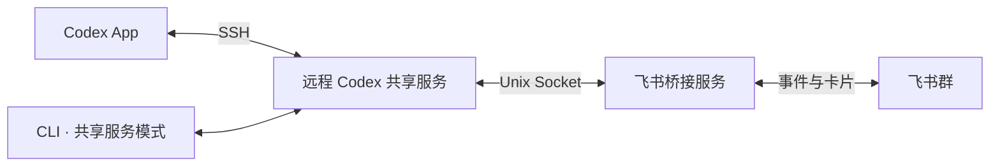

# 飞书与 Codex 双向会话连接调研

核验日期：2026-10-10（Asia/Shanghai）。范围：公开项目的一手文档与源码、OpenAI 官方文档、飞书官方 SDK，以及当前远程主机的只读协议探测。

**建议：第一类需求可先试 Agent Bot 或 modelzen/feishu-codex-bridge；两类需求都要满足时，优先开发一个连接 Codex App 原共享服务的飞书桥。已核验的六个项目中，未发现覆盖全部要求的稳定即用方案。**

后续已在当前 Codex 0.162.0 共享 daemon 的独立测试会话验证双客户端事件、原生队列消费、运行中 steer 和 App 会话接口读取；27 项断言通过。最新两期范围、完整证据与剩余联调项见[实施方案](/data00/home/chenxiaoyu.lemon/ai-tools/codex-feishu/docs/research/codex-feishu-implementation-proposal-2026-10-10.md)。下文保留初轮候选取证及只读探测记录；其中当时未验证的能力请以新方案的验证表为准。

本报告的“建议设计”是基于证据提出的实现路线，不代表桥接产品已经安装或交付。候选项目未运行；初轮本机探测为只读。后续测试使用临时目录和本地模拟模型，测试线程已归档，未发送飞书消息、修改全局配置、重启 daemon 或读取其他用户聊天内容。

## 开源项目调研

核验时间：2026-10-10 14:47（UTC+8）。依据项目自己的 GitHub README、源码、Release 和 Issue/PR；检查默认分支当前提交，未安装或运行候选，未读取用户会话。以下“支持”指文档与代码能够对应，尚无本机端到端验收。

**结论：飞书发起并由桥管理的会话已有较完整方案；已核验项目中未发现满足“SSH 远程 App/CLI 原活跃会话、人类输入和 AI 输出转群、群回复原地显示、steer 与 FIFO”全部能力的稳定即用方案。** `resume` 延续同一 thread 的历史，`fork` 新建分支，标题同步或共享 `CODEX_HOME` 提供历史可见性；这些都不能单独证明两个客户端连接同一活跃执行器。

### 候选与维护状态

日期按 Release 发布时间或默认分支提交时间记录；“无 Release”指 GitHub Releases API 本次返回空列表。

| 项目 | 许可证核验 | 最近 Release / 默认分支提交 | 最值得比较的能力 |
|---|---|---|---|
| [cc-connect](https://github.com/chenhg5/cc-connect) | README 声明 MIT；当前树未找到 LICENSE，license API 为 404 | [v1.5.1-beta.3](https://github.com/chenhg5/cc-connect/releases/tag/v1.5.1-beta.3)，2026-09-29；[dfad194](https://github.com/chenhg5/cc-connect/commit/dfad19415a38b00b2c5c288610784d1a7eef337f) | 飞书、多平台、多项目、历史会话、FIFO；Desktop 扩展尚为 Draft PR |
| [Agent Bot](https://github.com/keyou/agent-bot) | [GPL-3.0-only](https://github.com/keyou/agent-bot/blob/8abaa778497f5209cd70bb53b8f3176d14222894/package.json#L1-L10) | [v0.1.24-alpha.5](https://github.com/keyou/agent-bot/releases/tag/v0.1.24-alpha.5)，2026-09-25（北京时间）；[8abaa77](https://github.com/keyou/agent-bot/commit/8abaa778497f5209cd70bb53b8f3176d14222894) | 目录卡片、steer、持久队列、外部会话发现；明确拒绝接管外部执行 |
| [modelzen/feishu-codex-bridge](https://github.com/modelzen/feishu-codex-bridge) | [MIT](https://github.com/modelzen/feishu-codex-bridge/blob/6698118352d7eca87887d3ee1b58736caca204bc/LICENSE) | [v0.6.14](https://github.com/modelzen/feishu-codex-bridge/releases/tag/v0.6.14)，2026-09-24；[6698118](https://github.com/modelzen/feishu-codex-bridge/commit/6698118352d7eca87887d3ee1b58736caca204bc) | 群/目录、话题/会话、steer/queue，CLI 关键节点反向桥 |
| [agents-to-im](https://github.com/francize/agents-to-im) | [MIT](https://github.com/francize/agents-to-im/blob/92394e478801d872ada6f85d8f08bd38553946b6/LICENSE) | [v0.0.5](https://github.com/francize/agents-to-im/releases/tag/v0.0.5)，2026-04-23；[92394e4](https://github.com/francize/agents-to-im/commit/92394e478801d872ada6f85d8f08bd38553946b6)，2026-05-11，包版本 0.0.6 | 专属群、工作区选择卡、历史 resume、原生标题回写 |
| [codex-im-bridge](https://github.com/clawvisual/codex-im-bridge) | [MIT](https://github.com/clawvisual/codex-im-bridge/blob/db5c90d7db32fa6f344639019d1fc9803a5b51c9/LICENSE) | 无 Release；[db5c90d](https://github.com/clawvisual/codex-im-bridge/commit/db5c90d7db32fa6f344639019d1fc9803a5b51c9)，2026-03-16 | 工作区/线程选择、审批卡、可连接既有 WebSocket endpoint |
| [codex-lark](https://github.com/muggle-stack/codex-lark) | [MIT](https://github.com/muggle-stack/codex-lark/blob/1024012462a4ce5de2f173766dd6665c91bb5eb1/LICENSE) | 无 Release；[1024012](https://github.com/muggle-stack/codex-lark/commit/1024012462a4ce5de2f173766dd6665c91bb5eb1)，2026-09-07 | 现有 session 别名、目录参数、动态进度卡、全局 FIFO |

### cc-connect：主线与 Desktop 草案必须分开

主线提供飞书群消息、流式输出、`/dir` 切换下一会话目录、`/list` 和 `/switch` 历史会话操作。已核实的是目录命令，未确认所需的“首次 @ 后弹目录选择卡”。Codex 默认 `exec`，可选 `app_server`；后者仍由桥启动自己的 `codex app-server` 子进程，再 `thread/resume` / `turn/start`。忙时只保存消息，在当前结果到达后按顺序开下一轮，**不是 steer**。[使用文档](https://github.com/chenhg5/cc-connect/blob/dfad19415a38b00b2c5c288610784d1a7eef337f/docs/usage.md)、[后端启动](https://github.com/chenhg5/cc-connect/blob/dfad19415a38b00b2c5c288610784d1a7eef337f/agent/codex/appserver_session.go#L255-L315)、[排队实现](https://github.com/chenhg5/cc-connect/blob/dfad19415a38b00b2c5c288610784d1a7eef337f/core/engine.go#L3381-L3420)。

共享历史还存在实际反例：[Issue #1909](https://github.com/chenhg5/cc-connect/issues/1909) 报告 Desktop 加载 thread 后持有 writer 锁，`exec resume` 失败；隔离 `CODEX_HOME` 避开冲突，同时失去 Desktop 侧可见性。这是作者在 0.153.4 环境的报告，不能直接外推所有新版本，但足以否定“同目录即双向同步”。

值得持续关注 [Draft #1948](https://github.com/chenhg5/cc-connect/pull/1948)、[Draft #1949](https://github.com/chenhg5/cc-connect/pull/1949)、[Draft #1950](https://github.com/chenhg5/cc-connect/pull/1950)：转发原 Desktop AI 回复/公开进度，`/reply UUID --now` 对原 owner steer，`--queue` 持久 FIFO，另有审批回答与进度查询。本次 API 核验三者均 open、未合并。它们使用 **macOS 私有 Desktop IPC**，要求 App 和 watcher 常驻；指南偏钉钉，真实 Desktop UI 验收仍待完成，未验证 SSH 远程会话。固定于 #1949 的 [d895887 文档](https://github.com/NoFearInMyHeart-G/cc-connect/blob/d8958877759a8ab3559d2f4843590f6bcbcb2338/docs/codex-desktop.md)：队列只在派发时进入 Desktop；[转发代码](https://github.com/NoFearInMyHeart-G/cc-connect/blob/d8958877759a8ab3559d2f4843590f6bcbcb2338/scripts/codex-desktop/desktop.py#L126-L146) 只收完整公开 `agentMessage`，没有全量人类输入镜像。这是相关参考实现，尚非现成满足项。

### 第一类需求最接近的两个项目

**Agent Bot** 的 `/dir` 目录浏览卡、`/sessions` 卡、群 @、普通运行中消息 steer、`/queue` 独立下一轮均有对应实现；SQLite 按 `created_at, rowid` 出队，具备持久 FIFO。[目录卡](https://github.com/keyou/agent-bot/blob/8abaa778497f5209cd70bb53b8f3176d14222894/src/feishu/CardRenderer.ts#L1545-L1563)、[steer 路由](https://github.com/keyou/agent-bot/blob/8abaa778497f5209cd70bb53b8f3176d14222894/src/proxy/ProxySessionController.ts#L2842-L2861)、[队列](https://github.com/keyou/agent-bot/blob/8abaa778497f5209cd70bb53b8f3176d14222894/src/state/StateStore.ts#L582-L617)。

它能列出同 `CODEX_HOME` 下 Desktop/CLI 会话，但 [所有权检查](https://github.com/keyou/agent-bot/blob/8abaa778497f5209cd70bb53b8f3176d14222894/src/proxy/ProxySessionController.ts#L7395-L7437) 明确拒绝其他客户端正在执行的 turn，报“不会接管或追加消息”。[README 的 `/release`](https://github.com/keyou/agent-bot/blob/8abaa778497f5209cd70bb53b8f3176d14222894/README.zh.md#L278-L282) 用来释放 Bot 占用供 Desktop 接手；因此其外部发现、历史续聊及 fork 不能满足第二类需求。

**modelzen** 有交互建项目/绑定目录、群与话题映射、实时卡片和 steer/queue 设置；[后端](https://github.com/modelzen/feishu-codex-bridge/blob/6698118352d7eca87887d3ee1b58736caca204bc/src/agent/codex-appserver/backend.ts#L452-L462) 调用 `turn/steer`，[消费队列](https://github.com/modelzen/feishu-codex-bridge/blob/6698118352d7eca87887d3ee1b58736caca204bc/src/bot/handle-message.ts#L4688-L4710) 按 `shift()` 逐轮运行。[“咖啡一下”](https://github.com/modelzen/feishu-codex-bridge/blob/6698118352d7eca87887d3ee1b58736caca204bc/docs/release-notes/0.5.0-local-cli-agent-bridge.md) 通过 hooks 转发 CLI 审批与完成摘要，并允许完成卡续聊；目标是 owner 私聊。它不是 App/CLI 全程人类输入和 AI 输出转群；未找到接入 Desktop 原活跃 turn 的实现。适合第一类需求和关键节点通知。

### 其余候选的实质边界

- **agents-to-im**：私聊 `/new:codex` 选工作区并建专属群，`/resume:codex` 从原生历史恢复。群名回写实际是 `thread/name/set`；Codex runtime 自己 spawn app-server，消息走 `thread/resume` 后 `turn/start`。同会话通过 Promise 链串行处理；未实现 `turn/steer`，也未找到对外部活跃执行的持续镜像。[标题与恢复代码](https://github.com/francize/agents-to-im/blob/92394e478801d872ada6f85d8f08bd38553946b6/src/providers/codex/codex-provider.ts#L623-L631)、[独立进程](https://github.com/francize/agents-to-im/blob/92394e478801d872ada6f85d8f08bd38553946b6/src/providers/codex/app-server-client.ts#L221-L230)、[串行入口](https://github.com/francize/agents-to-im/blob/92394e478801d872ada6f85d8f08bd38553946b6/src/bridge/bridge-manager.ts#L800-L815)。
- **codex-im-bridge**：有目录浏览、工作区/线程切换和审批卡；可选 endpoint 是六者中较便于改接共用服务的结构。但当前发送入口只有 `turn/start`；`pendingDispatch` 是消息到 turn 的关联队列，入队后立即发送，不能当作“忙时等待”的 FIFO。未找到 steer 和外部人类输入镜像。[gateway](https://github.com/clawvisual/codex-im-bridge/blob/db5c90d7db32fa6f344639019d1fc9803a5b51c9/src/codex-gateway.ts#L112-L125)、[dispatch](https://github.com/clawvisual/codex-im-bridge/blob/db5c90d7db32fa6f344639019d1fc9803a5b51c9/src/feishu-bridge-runtime.ts#L300-L317)。
- **codex-lark**：`sess-alias` 绑定既有 ID，`sess-new --cd` 创建会话；README 宣称 App 可见。代码却是每次任务启动 app-server，resume 后开新 turn；无 steer，任务走全局 FIFO，跨会话也串行。未确认目录选择卡或 App 发起消息持续转群。[README](https://github.com/muggle-stack/codex-lark/blob/1024012462a4ce5de2f173766dd6665c91bb5eb1/README.md#L126-L143)、[FIFO](https://github.com/muggle-stack/codex-lark/blob/1024012462a4ce5de2f173766dd6665c91bb5eb1/src/bridge.mjs#L1279-L1305)、[resume/start](https://github.com/muggle-stack/codex-lark/blob/1024012462a4ce5de2f173766dd6665c91bb5eb1/src/bridge.mjs#L4072-L4114)。

### 选型建议与必要验收

实际使用时，应分别看会话身份、执行所有者、消息来源和投递目的地。列出一个历史会话只解决“找得到”；恢复其历史只解决“接着聊”；读取最后回答只解决“看得到结果”。第二类需求还要求桥持续识别从桌面和终端进入的新的人类输入，把桥外产生的回答投到绑定群，并将群消息发送给同一个仍在运行的执行器。现有项目多把飞书入站消息当作唯一执行起点，因此卡片更新能力很强，反方向的完整事件路由却不能由此推出。

同样，群和会话的映射不能只看“支持群聊”。Agent Bot 按私聊、群正文、话题维护当前任务，新话题首次普通消息可能从原轮次分支；modelzen 按群绑定项目、话题维护会话；agents-to-im 则由私聊控制面创建专属群。三种方式都能持续跟进，但默认交互入口不同。若硬性要求在既有群首次 @ 就弹目录选择、后续固定进入原会话，需要对这一步单独验收，不能把私聊建群或手输目录命令视为相同产品行为。[Agent Bot 路由说明](https://github.com/keyou/agent-bot/blob/8abaa778497f5209cd70bb53b8f3176d14222894/README.zh.md#L278-L282)、[modelzen 使用说明](https://github.com/modelzen/feishu-codex-bridge/blob/6698118352d7eca87887d3ee1b58736caca204bc/README.md#L88-L98)、[agents-to-im 命令](https://github.com/francize/agents-to-im/blob/92394e478801d872ada6f85d8f08bd38553946b6/README.zh-CN.md#L238-L257)。

部署到远程机器是合理路径，但这是基于项目执行结构的推论，并非已验证的 SSH 集成：目录浏览展示桥所在机器的文件系统；会话发现读取桥所用账户和会话存储。若桌面连接的远端与桥实际执行主机不同，即使目录字符串相同也不是同一个工作区。此次也未找到跨多台远程主机统一选目录、自动识别桌面连接目标的实现，不能把单机目录切换扩展解释为远程机器管理。

队列还应区分顺序和耐久性：内存数组可以保证单进程内的先来先执行，进程退出后未派发的消息却不当然保留。Agent Bot 的队列落在数据库，cc-connect 主线和 codex-lark 的上述代码使用进程内数组；Desktop 草案才额外提供持久队列。因此恢复历史会话、重启后继续聊天与重启后恢复未发送队列也是三个不同承诺。涉及取消任务时，还要确认排队项是继续、删除还是提示重发。

维护状态表仅给可复核的发布日期与提交；预发布标记不等同稳定版，无 GitHub Release 也不代表没有软件包发布。当前分支有能力不代表最近正式版必然包含，选定候选后应固定版本再次对照。较早的最后提交只能说明本次观察到的活动时间，不能据此断言项目已停止维护。

第一类需求优先比较 **Agent Bot 与 modelzen**：前者已有目录浏览、会话管理和持久队列；后者为 MIT、项目建群与话题交互完整。cc-connect 适合多平台和 FIFO 优先的场景，主线 steer 需要补齐。

第二类需求应以“连接远程 App 实际使用的执行服务”为验收核心；可借鉴 cc-connect 草案的原 owner 路由和防重复派发，以及 codex-im-bridge 的可配置连接层。仅把桥部署在 SSH 机器、共享磁盘历史或导入 session ID，仍不能算交付完成。

至少需实测：App/CLI 发起同一 ID → 人类输入与 AI 回复持续进入指定群 → 群内 steer 保持原 ID/当前 turn 并出现在 App → A/B/C 队列严格按顺序开后续轮次 → App 同时发消息、断线重连和消息重投不产生额外 turn。六个候选当前均未提供覆盖这整条远程链路的已核验证据；CLI 回显也应单列验收。

## Codex 与飞书的接入可行性

核验日期：2026-10-10，Asia/Shanghai。以下区分官方文档事实、本机只读验证和建议设计。没有创建飞书应用、发送群消息、向现有会话提交新 prompt、修改 Codex 配置或启停用户的服务。

### 当前环境的直接证据

这台远程机器安装的 CLI 和运行中的 App Server 均为 **0.162.0**。`codex app-server daemon version` 报告 `status: running`，控制端点为 `/data00/home/chenxiaoyu.lemon/.codex/app-server-control/app-server-control.sock`。官方说明 App 的 SSH 项目在远程主机运行 Codex 服务，因此桥接程序应该部署在执行任务的远程主机，并连接 App 使用的那个实例。[OpenAI 官方远程连接文档](https://learn.chatgpt.com/docs/remote-connections)

实际用两个独立的标准 Unix WebSocket 客户端，只进行了握手、初始化、加载线程列表查询、对本聊天的无配置覆盖 resume 和队列读取。`excludeTurns: true` 避免返回完整聊天历史。结果如下：

| 核验项 | 结果 |
| --- | --- |
| 控制 socket 的 HTTP Upgrade | `101 Switching Protocols` |
| 两个客户端同时 `initialize` | 均成功 |
| 两个客户端查询已加载线程集合 | 一致 |
| 两个客户端 resume 当前原 thread ID | 均成功，ID 没有变化 |
| 当前线程运行状态 | 两者均为 `active` |
| 当前线程 `canAcceptDirectInput` | 两者均为 `true` |
| `thread/queue/list` | 成功 |

这证明当前部署允许多个客户端连接同一实例，并加入同一活跃线程。**没有验证外部输入发出后 App 的消息气泡、实时 steer 的应用时机、队列自动执行或完整飞书收发**；这些仍是开发前 PoC 的验收项。不能把只读连接成功写成全部功能已经跑通。

复现接口检查的命令：

```sh
codex --version
codex app-server daemon version
codex app-server generate-ts --experimental --out /path/to/protocol
codex queue --help
```

0.162.0 的本机生成协议提供额外证据：

- `ThreadResumeParams` 注释明确说明：thread ID 已在运行时会重新加入它。新开另一个 App Server 后使用相同 ID 恢复历史，没有这个同实例保证。
- `ThreadItem` 包含 `userMessage` 和 `agentMessage`；用户项有 `clientId`，`turn/start`、`turn/steer` 支持 `clientUserMessageId`。这些字段可用于来源关联，但字段存在本身不保证请求幂等。
- 原生队列包含 `thread/queue/add`、`list`、`update`、`delete`、`reorder`、`start`，以及 `thread/queue/changed` 通知。本机 `list` 已读通，其余未写入测试。当前官方网页尚未列出这些队列方法，因此应按实际部署版本做兼容性探测。
- 本机 CLI 有 `--remote unix://PATH`、`--no-daemon`、`agents` 和 `queue`。CLI 回显也有共享服务的路线，不必预先放弃；独立运行模式需要另外处理。

本机 `codex app-server proxy --sock ...` 的两次短时只读探测没有返回协议数据，未定位原因；直接 Unix WebSocket 连接已成功。首版宜直接连接 socket，不能把 proxy 命令存在当作其在当前环境已验证可用。

### 各项需求如何实现

| 需求 | 判断 | 推荐机制 |
| --- | --- | --- |
| 飞书 @ 机器人创建会话，卡片选目录 | 可实现 | 自建应用机器人，目录下拉或逐级选择；确认后在共享服务 `thread/start` 指定 `cwd` |
| 飞书持续跟进原会话 | 可实现 | 保存 `host + threadId` 与飞书群/话题的映射；空闲时发送 `turn/start` |
| 正在运行时追加引导 | 协议支持，需写入 PoC | `turn/steer`，携带当前 `expectedTurnId`；与队列入口明确区分 |
| 消息排队 | 当前版本存在原生接口 | 优先共用服务端 `thread/queue/*`；验证排队通知、自动消费和 App 队列显示 |
| App 发起的会话自动转群 | 可实现，需发现与绑定规则 | 按项目/目录映射群；发现新 root thread 后在同服务 resume 并订阅；补取首次绑定前的消息 |
| App 人类输入与 AI 回复都转群 | 协议有对应数据 | 分别处理 `userMessage`、`agentMessage`；保留角色和来源，AI 增量聚合到卡片 |
| 飞书消息显示在 App 原会话 | 有明确实现基础，UI 未实测 | 在同实例、同 thread 上提交原生用户输入；App 消费线程事件，仍需验收实际气泡与刷新 |
| CLI 原会话双向回显 | 共享服务模式有路线 | CLI 显式连接同 Unix endpoint；独立 CLI 不承诺活跃会话双向写入 |

官方 App Server 文档公开了线程、turn、item 的生命周期以及 `turn/steer`。引导必须携带当前 turn ID，不能把中断后重启称作相同的 steer 行为。[OpenAI 官方 App Server 文档](https://learn.chatgpt.com/docs/app-server)

## 建议架构



桥接服务运行在远程机器，使用和 App 相同的系统用户、Codex home 和 daemon。连接已存在的控制 socket；不为每次消息启动新的执行器。只需要一个常驻桥接进程、一个飞书自建应用和少量持久化状态。新工具可以用 Go；如果复用现有项目，应先确认其 Codex adapter 能更换为“连接已有实例”，再评估改造成本。

### 飞书端

采用**自建应用机器人**。需要处理用户 @ 消息和交互回调，单纯发送 webhook 的群自定义机器人不能作为完整双向入口。订阅 `im.message.receive_v1` 和 `card.action.trigger`，按实际使用申请发送消息、群 @ 接收等权限，发布应用并拉入目标群。

用官方 SDK 的长连接接收事件与卡片回调，远程机器只需出站联网。官方 Go SDK 已有 `Channel` 封装，涵盖消息归一化、群 @ 策略、卡片回调和流式回复；首版也可使用基础 `ws.Client + EventDispatcher + API Client`，以部署版本实际提供的能力为准。[飞书官方 SDK](https://github.com/larksuite/oapi-sdk-go) · [官方 Channel 文档](https://github.com/larksuite/oapi-sdk-go/blob/v3_main/doc/channel.zh.md)

创建卡片建议包含：主机、已配置项目/最近目录、目录浏览入口、创建按钮。下拉选择用卡片组件；目录必须是真实远程目录，由桥接程序列举。卡片本身无法打开远程文件系统选择器。只允许配置的目录根和用户操作，确认目录后将规范化路径传给 `cwd`。[飞书单选下拉组件](https://open.feishu.cn/document/feishu-cards/card-json-v2-components/interactive-components/single-select-dropdown-menu)

同一群有多个 Codex 会话时，使用“一个会话一个群话题/根消息”。用户回复相应话题并 @ 机器人就能准确路由；群中无引用的消息可弹会话选择卡片。不要只保存“这个群最后一个会话”，那会让并行任务串线。如果希望每个会话自动建群，可作为另一种配置，增加建群及成员权限。

用户可通过 `/new` 创建、`/bind` 绑定已有线程、`/steer` 引导、`/queue` 排队；普通跟进采用空闲立即发送、忙时排队的默认规则，卡片也提供“立即引导/排队”按钮。这是建议产品行为，不要求照搬命令名。

### 同一会话的同步

1. 建立连接并初始化；识别服务器版本及能力。
2. 用 `thread/list` 按更新时间发现相关 root threads，结合配置的远程目录与群映射决定是否同步；周期校对弥补连接期间漏掉的新会话。不默认把 subagents 当独立群会话。
3. 对需要同步的原 thread 在**同一实例** resume，保持其模型、目录和审批配置，不传入覆盖设置；从历史快照补齐首次绑定时缺失的内容，再消费 item/turn 通知。
4. App/CLI 侧用户消息作为“人类 · Codex”转群，AI commentary/final 分别转发或按设置聚合。能准确识别具体输入来源时，再附上 App 或 CLI；不能仅凭 thread 的初始来源推断每条消息的客户端。飞书输入作为原生 user input 提交，使 App 收到同一线程的变化。
5. 维护消息来源关联。飞书输入已经存在于群中，服务返回 userMessage 时默认不再复制一份；使用消息 ID、`clientUserMessageId`/`clientId` 和持久化映射防止重复及机器人自我触发。
6. 断线后重新连接、重新订阅并按 item ID/游标补齐，不能把旧 delta 全部再发。飞书投递用 outbox 记录待发状态；超时先核对，再决定重试。

显示格式可满足用户的底部引用区要求，例如：

```text
只改这一个包，先运行现有测试。

────────────────
人类 · 来自 Codex App · 会话：修复邮件检索
```

```text
现有测试通过，修改涉及两个文件。

────────────────
AI 回复 · 会话：修复邮件检索
```

引用区用卡片底部说明文字或 Markdown 显示；无需伪装成实际人类账号发消息。默认同步用户输入、AI 进度和最终回复，工具原始日志按需展开。AI delta 聚合并节流更新同一张卡片，完成后用最终 item 校准；长回复分段，以免每个 token 都变成独立群消息。

### 引导、排队和并发

**引导**：读取当前活跃 turn ID 后调用 `turn/steer`。如果提交时 turn 已结束，向用户说明并按约定改为下一轮输入；不盲目重试到一个不同的活跃 turn。成功接收和指导已经被模型采用要分别展示。

**排队**：优先将输入放入原生队列，让 App 和飞书观察同一份待办顺序。验证当前版本是否自动消费队列、哪些客户端可以触发 `thread/queue/start`，以及 App 离线时谁负责推进。若需要桥接端推进，使用服务端队列的原子消费机制，避免 App 和桥接端重复启动同一条消息。不能仅因为存在 `queue/add` 就断言自动执行已成立。

若部署版本缺少原生队列，可用 SQLite 保存 FIFO 并在当前轮完成后发送。这个降级版本只保证桥接自己的队列；App 的排队列表不一定立刻显示，消息正式提交后才能作为用户消息回显。这个行为差异需要明确。

只对桥接进程使用每线程顺序调度还不够：App 也能提交。必须以服务器当前状态、turn ID 和队列消费结果为准。持久化发送意图与回执，发生超时先按客户端消息 ID 或历史核对，避免重复 prompt。第一版保持原会话审批设置，可先由 App 处理审批；若要关闭 App 后仍完整操作，再验证审批/提问请求的路由与客户端工具生命周期。

## 可选路线及限制

**Hooks 做补充同步**：官方当前提供 `UserPromptSubmit` 和 `Stop`，可获得用户 prompt 与最后的 assistant message，用于非共享 CLI 的消息转发。它们不能独自保证飞书消息成为 App 的原生用户气泡，也不等于持续流式输出；转录文件格式并非稳定接口，需要按版本适配。Hooks 要经过既有信任配置，不应该绕过。[OpenAI 官方 Hooks 文档](https://learn.chatgpt.com/docs/hooks)

**CLI 共享端点**：当前官方公开 `--remote unix://PATH`，可以让 CLI 与桥接服务连接同一个实例。如果 CLI 用独立服务、旧版本或 `--no-daemon`，优先提供单向转发或空闲后切换，不能宣称可以接管其独立活跃 turn。[OpenAI 官方 CLI 参数](https://learn.chatgpt.com/docs/cli/reference)

**桌面私有 IPC/界面自动化**：可以作为特定版本的实验路径，但用户以 App + 远程机器为主，当前有可直连的远程共享端点，优先使用这一层。App Server 仍标为实验接口，要固定支持版本并保留升级回归；不能当作长期不变的商业 API。[OpenAI 官方开发命令说明](https://learn.chatgpt.com/docs/developer-commands)

**MCP/skill 单独实现**：把飞书发送工具提供给模型，有助于显式发消息；完整双向镜像、线程路由与可靠队列应由常驻桥接进程处理。无需让 AI 每轮自行决定是否转发，也无需为这个场景另建 Responses API 会话。官方建议在需要对话生命周期和流式事件的产品中使用 App Server。[OpenAI 官方集成说明](https://developers.openai.com/blog/codex-as-a-platform)

## 开发顺序与验收

第一步只做共享会话 PoC，把最大不确定性先验证清楚：

1. App 在远程目录开会话，桥接连接同一服务：看到原用户输入、AI commentary 和 final。
2. 从测试入口给原线程发送一条正常用户消息，App 正在打开该聊天时立即显示；切换聊天、重连后仍存在，并且没有重复气泡。
3. App 任务执行中，外部 `turn/steer` 的补充确实进入该活跃 turn，不新建另一条历史分支。
4. 外部添加两条 queue，检查 App 显示、顺序、消费一次性；App 与桥接同时提交、重连和 App 离线时结果符合约定。
5. 桥接创建新线程后它能在 App 线程列表中找到，并有正确远程项目和目录归属。只创建持久 thread 不一定自动满足 App 的项目 UI 归属，需要检查 `projectId` 等 metadata。
6. 以共享端点连接 CLI，检查外部用户输入在终端可见；如果不能，按用户允许的范围降级，不影响 App 主流程。

通过后接入真实飞书测试群，加入目录卡片、群话题绑定、角色页脚、输入去重、长回复和断线恢复。先验证一台主机、一个群、一个项目，再扩大到多个目录/并行会话。作为个人工具的建议技术组合是 Go + 飞书官方 SDK + Unix WebSocket/JSON-RPC + SQLite + 用户级 systemd 常驻进程。

工作量仅作规划估计：熟悉双方 SDK 的开发者，共享会话 PoC 约 0.5–1 个工作日；单主机个人使用 MVP 约 3–5 个工作日；完善重连、升级兼容、并发队列和审批后通常需 1–2 周。端到端验证若发现 App 项目归属或队列 UI 限制，估计需重新调整。
