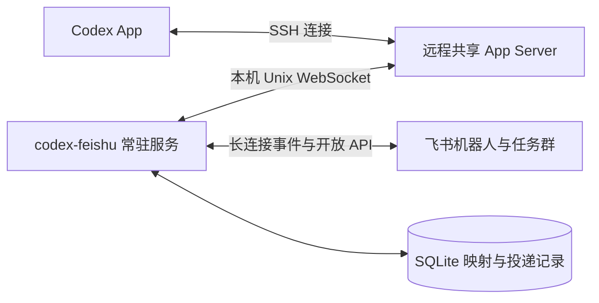

# 飞书与 Codex 双向同步实施方案

日期：2026-10-10。状态：方案已确认，尚未实施桥接产品。细化文档：[模块化开发手册](../codex-feishu/README.md)、[Agent 一键配置指南](../codex-feishu/AGENT-SETUP.md)。

建议开发独立的 `codex-feishu` 命令行工具，常驻在 Codex App 连接的远程机器上，接入 App 已在使用的共享 App Server。第一期完成 App 发起任务后的自动建群、上下文同步、飞书跟进、默认排队、显式追加引导和通知控制；第二期增加飞书新建任务、目录选择及群聊或话题选择。CLI 回显不作为两期交付项。

`code-anywhere` 只参考建群、群内跟进、目录 mute 和关闭 @ 的产品语义。卡片信息结构重新设计，采用飞书原生 Card JSON 2.0；实现采用已在本机验证过的 Codex 原生协议。

## 1 本地验证及采用条件

本机 CLI 和正在运行的共享 App Server 均为 **0.162.0**。验证直接连接其 Unix WebSocket 控制端点，新建独立测试会话，在临时目录使用本地模拟模型服务控制运行时序。没有向本次工作会话注入测试消息，没有修改全局 Codex 配置、重启 daemon 或发送飞书消息；测试会话均已归档。

| 验证 | 结果及设计含义 |
| --- | --- |
| 两个独立客户端加入同一正在运行的会话 | 成功，复用同一 thread ID 和 turn ID |
| 人类输入、AI 回复事件发给另一客户端 | 成功；可用于双向镜像 |
| 原生队列由两客户端共享 | 成功；飞书无需另外维护一套执行队列 |
| 普通队列项等待当前轮结束后按顺序执行 | 成功；忙时不会直接引导当前轮 |
| 从队列取出一项，再追加引导 | 成功；输入保留在原 turn，并实际进入模拟模型的后续上下文 |
| 引导时提交错误的 expectedTurnId | 明确拒绝，避免误注入另一轮 |
| thread/queue/start 在当前轮运行时调用 | 明确返回忙碌；不能用它实现运行中引导 |
| 相同 clientUserMessageId 重复 queue/add | 产生两项；该字段是关联标识，不是幂等保证 |
| 同一 queue/delete 重复调用 | 第一次 deleted=true，后续 false；可作为该队列项是否仍待消费的判断 |
| 追加明确失败后恢复队列 | 可保留内容与消息关联 ID；不承诺恢复原队列位置 |
| 飞书侧模拟客户端断开、重新连接 | 队列仍在，可以继续读到 |
| 中止当前轮 | 待执行队列保留，需要显式恢复执行 |
| 普通观察客户端接收新 thread/started | 本次测试成功；发现机制仍配合增量列表补偿 |
| 使用 App 的 read_thread 接口读取测试会话 | 实际读到初始输入、追加输入、后续排队输入及 AI 回复 |

主链路 17 项、边界流程 6 项、空闲队列入口 4 项，共 27 项断言通过。测试使用模拟模型，证明共享执行器、事件、队列和历史的协议行为；不是飞书真实收发或 App 界面的完整验收。

可复核文件：[主链路结果](/data00/home/chenxiaoyu.lemon/ai-tools/codex-feishu/docs/research/codex-feishu-probes-2026-10-10/native-queue-probe-result.json)、[边界结果](/data00/home/chenxiaoyu.lemon/ai-tools/codex-feishu/docs/research/codex-feishu-probes-2026-10-10/native-race-probe-result.json)、[空闲入口结果](/data00/home/chenxiaoyu.lemon/ai-tools/codex-feishu/docs/research/codex-feishu-probes-2026-10-10/native-idle-queue-probe-result.json)。同目录保留主链路与边界脚本；脚本会创建、归档测试会话，建议在开发验证时运行。

实现前的剩余必过项：用真实新建的 App 远程会话核验自动发现；检查 App 界面实时显示外部输入及队列；在飞书测试应用中验证卡片、建群和回调。共享连接、普通输入和引导这条技术路线已有本机证据，余下联调作为一期第一个里程碑。

## 2 开源参考与实现选型

现有飞书桥接项目可参考消息接入、目录和话题交互，但已核验版本没有直接覆盖本方案全部需求。原候选及源码证据在[开源调研](/data00/home/chenxiaoyu.lemon/ai-tools/codex-feishu/docs/research/codex-feishu-bridge-2026-10-10.md)。

补充发现的 [codex-tg](https://github.com/Arslan223/codex-tg/blob/4fddf7705b355dedd214493b4bff632a88f3873e/README.md) 是更接近目标的 Telegram 镜像参考：Go、SQLite、队列、引导、双向事件及远程 App 接入。其文档限定 0.148.0-alpha.15，使用启动 shim/broker，目标为 Telegram 话题；当前 0.162.0 本机已有共享 daemon，可直接接入。建议借鉴其持久化与事件组织，不把旧版本接入结构直接移植。许可证为 Apache-2.0。

建议实现为 **Go CLI + 飞书官方 Go SDK + Unix WebSocket JSON-RPC 客户端 + SQLite**。首版单机、单远程执行用户部署，不引入独立 Web 管理后台或消息中间件。

飞书使用企业自建应用机器人和长连接，订阅消息、卡片回调；官方 SDK 已提供接收策略、结构化 @、卡片和流式更新。需要开通创建群聊、管理成员、发消息及接收群 @ 的权限。执行主机能够出站连接飞书即可。[SDK Channel 文档](https://github.com/larksuite/oapi-sdk-go/blob/v3_main/doc/channel.zh.md)、[飞书自动群管理](https://open.feishu.cn/solutions/detail/groups?lang=zh-CN)

## 3 部署及结构



工具与 App 的执行服务使用相同远程主机、系统用户和会话存储。通过 `codex app-server daemon version` 发现当前 socket 和版本，不把路径写死。对已有会话调用 `thread/resume(threadId, excludeTurns=true)`，不传模型、目录、权限等覆盖值。官方说明 App SSH 项目在远程主机启动 Codex App Server；该协议提供会话与运行轮次的控制。[远程连接](https://learn.chatgpt.com/docs/remote-connections)、[App Server](https://learn.chatgpt.com/docs/app-server)

建议目录：配置 `~/.config/codex-feishu/config.toml`，状态 `~/.local/share/codex-feishu/bridge.db`，日志与诊断输出独立保存。用用户级 systemd 服务常驻。Codex socket 只在本机访问。

CLI 入口：`setup` 配置机器人和目录；`doctor` 检查共享连接、版本及飞书权限；`serve` 常驻；`status` 查看连接和待处理操作。安装、启动和卸载步骤在一期一起交付。

模块拆分如下，先实现直接满足两期需求的部分：

| 模块 | 责任 |
| --- | --- |
| codexclient | 初始化、RPC、事件、重连、版本与能力检查 |
| discovery | 新会话发现、元数据、目录规则、补偿扫描 |
| bindings | 会话与群/话题映射、建群状态和操作归属 |
| sync | 人类/AI 事件投递、流式合并、历史补齐、来源关联 |
| submissions | 输入收据、原生队列、追加引导、竞争与未知结果核验 |
| notifications | @ 目标、长期关闭、临时关闭、每日免打扰 |
| cards | Card JSON 2.0 模板、状态与回调 |
| creation | 二期任务草稿、目录选择、群/话题创建流程 |

## 4 一期功能与使用流程

### App 发起后自动建群

你在 App 的远程项目中提交第一条任务消息后，工具自动创建专属群，加入你与机器人，发送任务状态卡，再补齐这轮已经产生的人类输入及 AI 回复。默认一条主会话对应一个群，群名用项目名和简短任务标题，完整目录与会话标识放卡片详情。配置好的通知用户需在群内，才能被正常 @。

新会话通过 `thread/started` 发现，配合增量 `thread/list` 补偿漏事件。只处理持久化的普通用户主会话，排除子代理、临时线程和桥自己创建的任务；空白草稿在首次实际提交后处理。第一次启动建立基线，不批量给旧历史建群；旧会话可通过 `/bind <thread-id>` 接入。

当前本机元数据曾返回 `source=vscode`、`originator=codex-tui`、`threadSource=user`，因此不能把 App 来源写死成 `appServer` 或 `codex_desktop`。上线前用真实新 App 会话核验分类，结合持久状态、来源、父线程和自建任务标记。CLI 同一共享服务的事件可复用同步入口；CLI 界面的外部输入回显不列入验收。

建群前持久化创建意图，并以 `(host, threadId)` 唯一约束控制一个绑定。创建接口若支持去重标识，使用稳定标识；超时且结果不明时先核验已创建群，不盲目再次建群。群创建失败保留待绑定状态和事件，下次恢复后补齐。

### 两端上下文同步与群内跟进

- App 发出的每条人类输入转为飞书镜像卡。
- AI 公开回复流式更新对应卡片，完成后固定最终内容；公开进度与工具摘要可折叠显示。
- 飞书群内 `@机器人` 的普通消息进入绑定的原会话；机器人转发内容不会反过来再次进入 Codex。
- 飞书输入在 App 中按原生用户输入显示；排队期间目标是显示在 App 原生队列区，执行后进入聊天记录。
- 底部灰色引用区分别标记“人类发送 · Codex 端”“人类发送 · 飞书 · 发送者”或“AI 回复 · Codex”，附时间。只有有可靠元数据时才进一步标注具体 App/CLI 入口。

保留 `threadId/turnId/itemId` 与飞书消息 ID 的关联；以完整 item 为最终状态，用事件增量更新生成中的正文。断线后通过分页历史接口补齐，对已投递 item 更新原卡而不是再次新发。飞书发出的输入以收据关联自己的原消息与状态卡，消费事件到来时更新该卡。

默认只允许配置的操作者提交任务和管理规则，其他配置用户可接收提醒。权限仍沿用原 App 会话；待审批、待用户回答状态在任务卡显示。审批/问答若要直接在飞书处理，必须另做原生请求路由及双端答复竞争验证；未通过时引导回 App 处理，不把普通排队文本当审批答复。

### 默认排队和显式追加引导

普通输入统一使用原生 `thread/queue/add`：空闲时自动发起下一轮，忙时保持排队。这样由服务端判断状态，避免客户端判断“空闲”后 App 恰好启动新一轮，误把普通输入引导进去。原生队列能与 App 共用，桥的 SQLite 保存投递收据而不另做执行队列。

排队卡展示“已排队 · 第 N 条”、消息摘要、“当前轮结束后执行”，提供主按钮“追加引导”和次要按钮“移除”。Native queue 改变时刷新真实位置。App 自己的排队输入也从原生队列读取；两端在各自支持的操作范围内共用这个顺序。

追加引导流程必须处理两个 RPC 之间的竞争：

1. 卡片回调核验操作者、绑定和队列项，在 SQLite 写入操作意图，同会话的桥操作串行处理。
2. 调用 `thread/queue/delete`。只有 `deleted=true` 才继续；返回 false 表示已不在队列，核验历史后更新卡片，不重复注入。
3. 调用 `turn/steer`，携带原消息关联 ID 和准确的 `expectedTurnId`。
4. 成功改卡片为“已追加至当前轮”。明确被拒绝且确认没有接收时恢复入队，提示位置可能变化；若当前轮已经结束，按后续消息保留。
5. 任一请求断线、超时而结果不明时进入“正在核验”，检查原生队列和用户 item 的 clientId；核验前不自动重复提交。不能把“队列项消失”单独判为成功。

这是带持久记录和补偿的流程，不是跨 RPC 的原子操作。桥的本地锁也不能锁住 App 的独立操作。通过原生 delete 结果、turn 前置条件及收据核验处理并发，而不是承诺客户端锁能消除所有竞争。

卡片“停止当前轮”调用 `turn/interrupt`，保留待执行消息。停止后默认不自动恢复，卡片提供“继续执行队列”；空闲时调用 `thread/queue/start`，并处理 App 同时启动导致的忙碌返回。

### 目录 mute

建议命令在机器人单聊或已有任务群执行：

```text
/mute-dir /path/to/project
/mute-dir /path/to/project --recursive
/unmute-dir /path/to/project
/mute-dir list
```

第一条只禁该目录未来会话的自动建群，第二条包含全部子孙目录。规则持久化并解析真实路径，使用路径边界比较；`/repo/a` 不会匹配 `/repo/abc`。工作树通过项目原目录与实际 cwd 一起判断，确保屏蔽项目能覆盖另处生成的 worktree。

目录 mute 只控制未来自动建群：已绑定群继续同步，显式 `/bind` 或二期新建仍可操作；解除规则不会突然批量创建历史群。命令反馈清楚显示作用范围与递归状态。

### @ 提醒与免打扰

配置接收提醒的用户 ID，使用飞书结构化 mention。默认最终结果、失败和待用户处理状态才 @，流式正文和普通进度更新不 @。发消息时重新检查规则，所有任务群共同遵守用户的免打扰设置。

```text
/notify at off                       长期关闭对自己的 @
/notify at on                        恢复，仍遵守每日免打扰
/notify at snooze 2h                 暂停两小时
/notify at until 2026-10-11 09:00     暂停至指定时间
/notify at quiet 23:00-08:00          每日跨午夜免打扰
/notify at quiet off                 删除每日时间段
/notify at status                    查看当前生效设置
```

时间默认 Asia/Shanghai，反馈卡显示时区与恢复时间。每个通知用户可控制自己的 @；操作者配置通知目标。长期关闭、临时暂停、每日免打扰任一命中就不 @。免打扰期间内容照常同步，结束后只对新事件提醒，不补发积压 @。关闭 @ 控制机器人的 mention；飞书客户端普通群消息提醒仍由用户的飞书设置决定。

## 5 二期功能与流程

### 创建入口及目录选择

`/new`、机器人单聊普通消息、未绑定入口群中的 `@机器人 + 普通消息`，都进入预填任务内容的创建卡。已绑定任务群中的普通消息继续原会话；在该群明确 `/new` 才开启新任务。避免用户正常补充内容时意外多建会话。

创建卡只有一个最终目录选择值。默认展示当前远程机器、常用项目/目录、任务内容、跟进位置和“创建任务”。“选择其他目录”打开独立目录选择卡，支持浏览允许的路径与直接输入绝对路径；选完回到原草稿。继承 App 的 projectId 时先通过 `project/list` 核验。目录存在性、权限及真实路径均在远程执行主机校验。

### 群聊或话题

跟进位置默认为“专属群聊”，可改为“当前群话题”。

| 模式 | 创建及跟进 |
| --- | --- |
| 专属群聊 | 新建你与机器人的任务群，把新 Codex 会话绑定到该群，创建完成卡给出群链接 |
| 当前群话题 | 在选定工作群发送任务根卡，保存 root/thread ID；本话题的消息只路由到此会话，所有回复保持在本话题 |

从单聊选择话题时，需要选择一个已授权的工作群；有明确默认工作群时可预选。不存在目标群时仍留在创建草稿，不把单聊当话题。

话题路由保留飞书 RawEvent 中的 root/thread 信息，并通过开放 API 明确控制回复位置。SDK 默认“被回复消息撤回后退回普通群消息”的降级，不适用于话题隔离；这一分支直接处理原始 API 错误，提示重新绑定话题，避免内容散到群主界面。

### 创建的执行顺序与 App 可见性

持久化草稿并生成唯一创建令牌 → 校验目录与模式 → 创建或复用目标群/任务根卡 → `thread/start` 携带 cwd、可选 projectId 及自建来源标记 → 保存映射 → 通过原生队列提交首条输入 → 更新创建卡与任务卡。

群创建、线程创建、首次输入分别保存结果；重复回调从已完成步骤继续，不从第一步重新创建。线程创建后尚未产生第一条输入时，另一客户端可能暂时读取不到 rollout，本机已观察到该边界；用持久化状态和重试等待首次提交落盘。

新线程打自建标记并预建绑定，避免一期发现器再自动建第二个群。验收要求会话真实出现在 App 中、目录与项目归属正确，并可从 App 或飞书继续同一 ID。

## 6 卡片设计

采用 [assistant-ui 队列组件](https://www.assistant-ui.com/docs/api-reference/primitives/queue-item) 的显式 Steer/Remove 语义，以及 [AI Elements Task](https://elements.ai-sdk.dev/components/task) 与 [Message](https://elements.ai-sdk.dev/components/message) 的内容、状态、详情分层。React、Tailwind 等 Web 组件只作交互参考，卡片用飞书原生实现。取证与组件约束见[卡片研究](/data00/home/chenxiaoyu.lemon/ai-tools/codex-feishu/docs/research/codex-feishu-card-ux-2026-10-10.md)。

| 卡片 | 首屏信息 | 操作和变化 |
| --- | --- | --- |
| 任务状态 | 简短标题、运行/待确认/已完成等文字状态、项目、最新动作 | 执行详情折叠；运行时停止，停止后继续队列 |
| 排队输入 | 内容摘要、真实排队位置、结束后执行说明 | 主操作追加引导、次操作移除；点击后处理中，确认后已追加/已移除 |
| AI 回复与人类镜像 | 正文优先，底部灰色来源引用区 | AI 流式更新同卡；日志折叠；最终状态固定 |
| 任务创建 | 已选目录、任务内容、群聊/话题、目标位置 | 单个主提交按钮；目录选择独立卡；提交后禁止重复创建 |
| 通知设置 | 当前 @ 状态、时间段、作用范围 | 常用临时暂停入口，完整配置由命令操作 |

视觉采用单列、短标题和原生主色按钮，颜色只辅助状态文字。手机上主操作始终可见，长路径放详情，不依赖悬停或拖拽。不画虚假的进度百分比。

回调快速返回“已收到，正在处理”，后端异步更新；成功文案须等 Codex 或飞书操作确认。失去连接时禁用依赖实时轮次的按钮，显示最近已知状态。表单放卡片顶层，队列状态按钮不是浏览器组件。[飞书原生卡片结构](https://open.feishu.cn/document/feishu-cards/card-json-v2-structure)、[回调通信](https://open.feishu.cn/document/feishu-cards/card-callback-communication)

## 7 持久状态和投递保证

SQLite 至少保存四类记录：会话绑定与建群意图、飞书输入/卡片操作收据、事件投递与消息映射、目录/通知设置。输入收据以飞书 message ID 唯一，按钮操作以服务端令牌及版本唯一；不可把 Codex 的 clientUserMessageId 当去重键。

收据状态：已接收、待提交、已排队、正在引导、已确认、结果待核验、明确失败。与原生 queuedSubmissionId、turnId、user item 关联。发送请求前写意图；重启后先核验结果再决定是否继续，不根据超时自动重复执行。

同步恢复以持久 item ID 和飞书消息 ID 补齐；流式 delta 只用于生成中展示，完整 item 用于纠正丢失增量。投递节流和飞书返回的限流信息一起控制更新频率；最终回复即时尝试投递，短暂失败入 outbox 重试，发出时重新判断 @ 政策。

Codex 原生接口及共享 daemon 处于持续演进中。首版固定已验收版本与能力集合，`doctor` 在启动/重连时检查；不能满足共享输入条件时显示明确不可写状态，保留待处理收据供恢复。不要把另一个服务恢复历史当成同一活跃会话的替代交付。

## 8 交付顺序与验收

以下为单人开发估算，包含联调，不是日历日期承诺。

| 顺序 | 交付 | 估算 |
| --- | --- | --- |
| 一期 M0 | 将已验证协议接入最小桥；真实 App 新会话发现、队列显示、飞书测试群和卡片回调联调 | 1–2 工作日 |
| 一期 M1 | 自动建群、原会话跟进、人类/AI 同步、基础状态与回复卡 | 3–4 工作日 |
| 一期 M2 | 默认原生队列、追加引导、移除与停止/继续、持久去重、断线核验 | 3–4 工作日 |
| 一期 M3 | 目录规则、@ 规则、doctor/安装与诊断、故障和手机布局验收 | 2–3 工作日 |
| 二期 M4 | 普通消息与 /new 创建入口、目录选择、群/话题路由、App 项目关联、创建恢复 | 4–6 工作日 |

一期约 9–13 工作日，二期约 4–6 工作日。M0 未通过时先解决共享服务与 App 实际交互问题，再进入后续产品实现。

一期必须通过以下场景：

1. App 新建普通远程会话 → 仅创建一个群 → 首条人类输入与 AI 回复均出现；子代理不单独建群。
2. 群内 @ 后，App 在同一会话看到输入；忙时默认排队，当前轮不被普通输入改变。
3. 连续 A/B/C 按原生顺序执行，App 与飞书看到一致队列；点击某项追加只进入当时目标轮，原排队项不再重复执行。
4. 重复消息事件、重复按钮、App 同时改队列、结束瞬间追加、删除已消费项、RPC 断线，都进入正确确认/核验状态。
5. 目录精确/递归规则覆盖符号链接、同前缀不同目录和 App worktree；解除规则不会给历史聊天批量建群。
6. 通知 off、snooze、until、跨午夜 quiet、重启后规则恢复及多群同时结束均正确，休息时没有机器人 @。
7. 停止保留队列，恢复明确由用户触发；桥重启后能续接原群、补齐内容及恢复收据。
8. 飞书手机与桌面检查真实卡片；App 界面确认用户输入、队列与结果实时显示。审批仍由原会话策略控制。

二期另验收：普通消息和 /new 均可创建；默认专属群、选话题后严格隔离；目录/项目准确；重复提交和“群已建但首次执行失败”不制造第二个任务；App 可以继续同一会话。

审核主要看四个默认值是否符合使用习惯：一期以 App 远程会话为核心；普通消息一律走原生队列入口；最终结果/待处理/失败才 @；目录 mute 只关闭未来自动建群。其余设计围绕这些行为实现。
