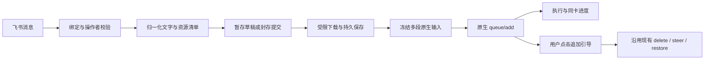

# 飞书向 Codex 发送图片与文件：实施方案及估算

日期：2026-10-15。状态：基础实现已完成，候选尚未升级；真实 Feishu/App UI、模型视觉、文件工具、手机和大图验收仍待完成，详见[实施记录](feishu-inbound-attachments-implementation-2026-10-15.md)。基于当前部署 `8fb72d6`、已验证兼容的共享 App Server 0.162.1 和现有原生队列方案；不改变会话策略、不启动第二个 app-server。飞书事实及 SDK 限制见[接口调研](feishu-inbound-resources-2026-10-15.md)。本方案中的限额、草稿规则和工作量是设计建议，不是平台保证。

按本次讨论更正后的 AI 编码口径：由当前 Agent 直接在已有代码库实施，完整基础版本预计 **4–8 小时有效工作时间**，包括多图、文件、暂存合批、原生排队/引导、恢复、测试和部署；图片闭环预计 **1–2 小时**先交付。两者不是相加关系。权限发布和等待用户联调的时间另计；如遇原生协议或 App 兼容问题，可能延长到一天。这是当前代码和已知风险下的估算，不是保证完成时刻。

## 1. 用户能获得什么

| 场景 | 建议行为 |
| --- | --- |
| 一条消息包含 @、文字和一张或多张图片 | 保留文字与图片顺序，整体提交原生队列；图片按视觉输入处理 |
| 连续发送多张图片或多个文件，再说明需求 | 附件进入当前发送者的待发送草稿；更新同一张附件卡；下一条普通 @ 对话随这些附件整批提交 |
| 只有附件，没有文字 | 默认暂存，不自动启动多轮任务；可在附件卡填写说明并点“发送给 Codex”，也允许不填说明发送 |
| 正在执行时发送带附件的需求 | 默认排队；队列确认后才提供“追加引导”，点击后把原来的完整文字和全部附件加入当前轮 |
| 下载失败或超限 | 显示哪份附件失败；不静默丢附件后只提交文字；可重试下载或明确移除失败项 |
| 查看反馈 | 原附件/指令消息有 reaction；草稿、收取和排队状态分别说明；过程卡持续更新、最终结果引用提交来源 |
| App 中继续跟进 | 使用原线程的真实输入，验证 App 中的图片、文件引用和输入正文可见；不再在飞书重复发布这些人类输入 |

独立附件草稿按 `(host, app, thread, chat, sender)` 隔离。原附件消息 ID 和资源 key 始终保留；不把其他成员的附件、其他任务群内容或历史附件猜进来。一个草稿的收取进度和附件数量更新在同一卡中。卡片只展示名称、数量和短状态，完整本地路径默认不进入飞书正文。

下一条用于提交草稿的消息必须是普通对话 @；`/stop`、`/notify`、`/mute-dir` 等管理命令不消费附件。新 @ 图文若已有暂存附件，则显式将两者组成同一批，按“已有暂存资源、当前消息内容”排序，并在卡片显示本批数量。附件卡提供“发送给 Codex”和“清空”；不能把“已收到附件”显示成“已进入 Codex 队列”。

发送时原子封存当前草稿的版本及资源集合；发送后到达的附件进入下一批。按钮重复点击或下一条 @ 与按钮同时发生时只能有一次有效提交，落败的动作提示本批已发送，不启动第二轮。附件草稿与原生执行队列分开，草稿不计入 App 已排队数量。

消息回复关系：通过文字 @ 提交的输入，过程和结果引用该 @ 消息；通过卡片提交时引用该草稿首次附件消息，卡片底部列出本批附件来源。附件 reaction 至少区分“收到、待发送/收取中、已排队、执行、完成/失败”，排队和最终状态必须有原生确认。继续复用既有反应、出站日志、通知及免打扰规则。

## 2. 已确认的接口能力与待实测项

**图片原生能力已由文档和本机 schema 确认。** OpenAI Docs 的 App Server `input` 支持 `text`、`image`、`localImage`，`turn/steer` 将更多用户输入追加到当前轮。当前 0.162.1 导出 schema 中，`thread/queue/add`、`turn/steer`、`turn/start` 都引用同一个 `UserInput` 联合类型，包含 `localImage`。[官方 App Server 文档](https://learn.chatgpt.com/docs/app-server)

**普通文件不能假装成原生 file part。** 当前三个 schema 的 `UserInput` 变体为 `text`、`image`、`localImage`、`audio`、`localAudio`、`skill`、`mention`，没有通用 `file/localFile`。因此文件落在远程机器，通过有明确文件名和绝对路径的文本附件清单交给 Agent 的现有工具读取；不冒用 `mention`。文件正文不整份塞入提示词，保留原始文件。普通文件在 App 中至少显示可读引用；能否具有与 App 原生上传完全一致的附件控件外观，须真实验收，不作为 schema 已证明的能力。

本机已导出的 schema 核验摘要（原文件为当前协议研究缓存，不提交临时目录）：

| schema 文件 | SHA-256 |
| --- | --- |
| ThreadQueueAddParams.json | `60f25b7d3e3357c215bef9d2fe7047200f545e030dca9e00527ac0620cd0c88f` |
| TurnSteerParams.json | `99f7fdff8b090065b68f36420b70870b5eafed048c024b308230aaa02f15d891` |
| TurnStartParams.json | `062373a7dfc290b506e591bc5c2a35005211df27b3c60358cee3efed12859062` |

**飞书下载走消息资源接口。** 使用资源原消息 ID、image_key/file_key 和应用 tenant token 下载。图片、文件上传接口的 10 MB/30 MB 上限不等于入站下载上限；首版主动设置较小产品预算即可，无需实现大文件 Range。[下载消息资源](https://open.feishu.cn/document/server-docs/im-v1/message/get-2.md)

**单独发图片、文件的群入口需要新增接收范围。** 普通 `image/file` 没有可假定的结构化 @；推荐开通 `im:message.group_msg`，并具备下载基础读取权限之一。即使收到全群事件，业务层仅处理已绑定专属任务群中 operator 的独立附件；普通文字仍要求 @，未绑定群和其他成员不进入草稿。权限只在启用附件特性时要求，更新 doctor/配置向导的能力清单。[消息接收权限](https://open.feishu.cn/document/server-docs/im-v1/message/events/receive.md)

若不接受全群读取权限，可选择较小版本：仅支持同条含 @ 的图文消息。不能保证引用任意纯文件消息能绕过该权限；按 ID 补读群消息本身也有群读取要求。[读取指定消息](https://open.feishu.cn/document/server-docs/im-v1/message/get.md)

Schema 和源码分析尚未证明真实 App 的图片回显、文件访问、队列图片恢复及体积表现。第一个开发切片必须完成这些真实验证，再继续完整功能；不把 DTO 能解析当成 App 已支持。

## 3. 数据和执行链路

1. **消息解析。** 将当前只返回字符串的 `Text` 路径扩成包含文字、图片、文件及来源 ID 的结构化结果。post 按文档选用一种内容表示，保留链接、代码和换行；不能拼接 content/content_v2 造成重复。只从校验后的事件解析资源 key，不抓正文任意 URL，不使用用户提供的本地路径作为下载目标。
2. **草稿及收据。** 持久化原事件去重、草稿 revision、资源顺序、发送者及目标绑定。下载异步进行，事件处理不等待二进制传输。提交时一次关联既有 receipt/client ID，并冻结当前批次；已有纯文本收据和状态保持兼容。
3. **下载与文件保存。** 单独资源 worker 复用应用身份，使用受控 HTTP 流式落盘。当前 SDK v3.12.0 的 Reader 实际已完整缓冲，不能照搬为流式实现。校验 HTTP 状态、错误体、实测字节、图片类型与像素；写临时文件，完成校验后原子变成可用资源，再提交数据库 ready 状态。崩溃恢复检查已存在文件的摘要，不能重复创建不一致的成品。
4. **原生输入。** 图片构造 `localImage`；文字和一般文件引用构造 `text`，保存为完整 `input_json`，与显示正文 `Body` 分离。Add、Steer、失败后的 Restore 都读取同一个冻结输入，不能只有首次 Add 含图片、引导却退化为文字。引用必须是共享 daemon 所在远程机器的绝对路径。
5. **排队与顺序。** 整批附件准备好才允许原生 Add；同一会话的飞书提交按封存顺序处理，后来的文字不能越过前面正在收取附件的提交。资源收取达到重试上限后，该批明确转为失败并通知，后续输入可继续，不能永久阻塞会话；用户之后重试该失败批次时重新取得提交顺序，保留原关联且不重发任何已确认原生输入。一个任务群下载较慢不阻塞其他任务群。App 直接提交的消息与飞书消息最终以原生队列接受顺序为准，不声称能把下载尚未完成的输入倒插到 App 队列。
6. **引导与未知结果。** 复用现有默认排队、显式引导、停止/继续、旧卡失效和原生确认流程。原生结果未知时只凭队列/历史的原关联核验，不再次发送文字或附件。临时资源下载是 GET，可限时重试；这不授权重试未知的 queue/add、steer 等操作。

新增资产记录至少保存来源消息、资源 key、原名、类型、大小、内容摘要、本地文件 ID、下载状态及 receipt/草稿引用。文件内容不写 SQLite、普通日志或 Git。预计需要一次向后兼容的数据库迁移；版本号以实施时主分支实际版本确定。迁移前停桥并做一致备份，不停止 Codex daemon。

## 4. 文件类型、体积和生命周期

基础交付包括静态 PNG/JPEG/WebP 图片以及通用文件的传输与引用。文本、JSON、CSV、Markdown、代码可由 Agent 的现有工具读取；PDF、DOCX、XLSX 等也能保存并作为文件交给 Agent，但内容提取受远程主机工具与原会话读取权限约束。**通用文件投递不等于已实现所有文档解析。**

如需稳定的 PDF/Office 文本提取、PDF 逐页图片、扫描件 OCR，作为独立增强，按样例、支持格式和本机依赖另行估算，不计入基础版本的 4–8 小时；扫描件、大表格和复杂版式需各自语料验收。压缩包不由桥自动解压或执行，用户后续明确要求时由原会话工具在既有权限内处理。文件夹、音视频及合并转发递归解析不属于基础交付。

首版建议可配置预算：每批最多 5 张图片、每张最多 10 MiB、图片合计 20 MiB；单个普通文件最多 20 MiB；每批最多 10 个资源、合计 50 MiB。还需限制图片总像素、并发下载及全局磁盘额度，具体像素预算在图片实测切片后固定。所有数值是拟议产品限制，不冒充飞书或 Codex 的上限。

保留原始图片，不默认有损压缩、截断长图或悄悄少传文件；超限明确提示。使用 `localImage` 减少桥接 RPC 里嵌入大段 base64，但 Codex 仍会处理图片字节，不能据此保证 App 不再受大图影响。必须实测多图队列、历史恢复、内存及消息体预算，结合此前大图故障防止回归。

资源目录按会话及资源 ID 隔离，目录 0700、文件仅当前系统用户可读；原始名称只作显示，不能用于目录穿越或命令插值。下载不自动执行文件，也不扩大原线程沙箱；若读取受策略限制，沿用原审批流程并明确失败原因。正文与附件引用应标明附件属于任务材料，附件内文字不冒充新的用户指令。

下载未完成、原生排队、引导/恢复未决的资源必须保留。已提交的普通文件会被后续对话再次引用，默认随会话保存，不按“本轮完成”自动删除；草稿可设过期时间并明确提示。首版提供用量和清理未引用缓存的管理方式，磁盘达到额度时拒绝新批次，不能删掉仍有引用的旧附件腾空间。

## 5. 模块与 AI 执行时间估算

| 切片 | 涉及模块及明确产出 | AI 有效工作时间 |
| --- | --- | ---: |
| M0 原生图片实测 | codexclient；同线程图片 Add/Steer、App 显示、普通文件读取、体积及恢复探针；失败先调整方案 | 0.5–1 小时 |
| M1 消息与权限 | feishu/app；image/file/post 归一化、群范围过滤、下载与全群接收权限能力清单 | 0.5–0.75 小时 |
| M2 下载与资产持久化 | feishu/附件模块/store；流式限额、摘要、原子文件、持久下载与恢复 | 0.75–1.5 小时 |
| M3 批次和原生输入 | app/store/codexclient/submissions；隔离草稿、封存、旧数据迁移、多段输入 Add/Steer/Restore、FIFO | 1–2 小时 |
| M4 反馈交互 | cards/app；同一卡收取与待发送、真实队列卡、reaction、引用关系及去重 | 0.5–0.75 小时 |
| M5 验收和部署 | fixture/故障/竞态测试，真实 App 和飞书、重启及既有功能回归，备份和部署手册 | 0.75–2 小时 |
| 合计 | 当前 Agent 在既有仓库上实施，不含外部等待 | **4–8 小时** |

先完成“同条 @ 图文”的受控图片增量，目标约 1–2 小时给出可验收版本；完整文件/草稿功能完成后统一推广。仅能下载一张图片的原型不算图片闭环验收通过。

普通引用附件补读、话题附件路由不作为基础必需功能；主方案用明确草稿处理多附件。若追加一层精确普通引用补读、话题附件或 >=100 MB 的 Range/断点续传，按新增范围另行估算，不沿用人工人日，也不计入上述基础版本时间。话题内 root/parent 的语义须单独实测，不能当普通引用处理。

## 6. 验收及用户协助

自动验证应覆盖：纯文字旧路径不变；图片/文件 MIME 与中文名；post 顺序及双重表示；同批失败不漏传；重复事件与并发双提交；下载中断、磁盘失败及崩溃后的原子恢复；队列 Add/Steer/Restore 使用同一完整输入；未知响应不重发；停止后队列保留；草稿/排队资源不被清理；跨群、跨用户和旧卡不能操作其他批次。

真实环境分两轮，用户操作预计合计约 20–30 分钟，权限发布等待另计：

1. **图片与显示**：一张图、同条两张图加说明、边界体积多图；App 看到真实输入及图片，AI 能辨认测试图片内容，群中无重复人类镜像；确认收取卡/过程卡/最终回复引用。
2. **完整附件流程**：连续多附件合批、读取文件内部的随机标记；忙时默认排队、只引导选定输入、停止与继续；保留一批待发送或排队附件重启本桥，确认无丢失或重复。App/手机的附件入口和反馈单独确认。

需要用户一次性在飞书应用后台开通经 doctor 确认缺少的读取权限并发布。无需提供新的模型 API key，沿用当前 Codex 登录、原共享 daemon 和原会话。权限不可开通时交付最小权限的 @ 图文切片，明确不把群纯文件输入标记为通过。配置向导同步新增特性开关、权限差异、附件限额与存储目录说明。

完成只证明本功能验收；既有归档绑定和未知历史投递等待核验项保留，不借此次功能部署提升完整一期发布状态。
